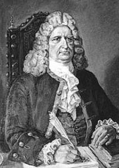
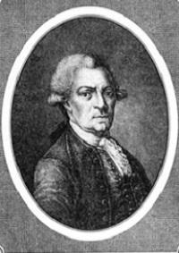
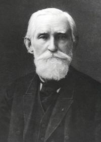
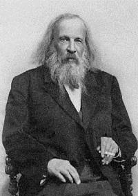
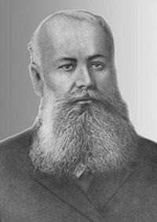

# History of St Petersburg University

The Czar Peter the Great founded St Petersburg University as part of a new and complete system of science and education in Russia. The system was comprised of three institutions: the Russian Academy of Sciences, the University, and the Academic Gymnasium. In a decree of 28 January, 1724 the Senate outlined the purposes of the new institution: "The University is a gathering of learned persons to teach youth such noble sciences as Theology, Law, Medicine and Philosophy as we know them today."

Prominent men of learning were among the University's first professors, the mathematicians Euler and Bernoulli, for example. The famous German historian and ethnographer Gerhard Friedrich Mueller  was appointed in 1747 to be the University's first rector, a newly created position. The 2nd rector was Stepan Krasheninnikov — a geographer and explorer of Siberia who gave the 1st full description of Kamchatka in the early 18th century which is still relevant and significant. It was even re-issued in 1994.

  

| | |
| --- | --- |
|  |  |
| Gerhard Friedrich Mueller | Stepan Krasheninnikov |

  

The great Russian scholar Mikhail Lomonosov made a significant contribution to the development of the University. He was the University's rector from 1758 to 1765 and taught at the school for a number of years. He made projects on reorganization and improvement of the University: implemented curricula and syllabi, started teaching in the Russian language introducing the first physics course in Russian in 1747, asserted the right of the lower class to study at Gymnasium and University. Lomonosov’s seven years of rectorship are considered to be the period of the highest activity of the University in the 18th century. Most graduates became famous scientists then.

In the late eighteenth century teaching at the University came to a virtual standstill. The Academic Gymnasium still taught students as late as 1804. Its last students were then transferred to the Pedagogical Institute, formerly the Teachers' Seminary which had opened in 1783. The Pedagogical Institute then grew to replace the University as an institution of higher learning. It was used as the base for a revived St Petersburg University in 1819 when Czar Alexander I issued a decree proclaiming the re-establishment of St Petersburg University.

The re-established University had three faculties: the Faculty of History and Philology, the Faculty of Philosophy and Law (later the Faculty of Law), and the Faculty of Physics and Mathematics. The Faculty of Oriental Languages was added in 1854. The University retained this structure until 1918.

In 1830, the Twelve Colleges building designed by the architect Domenico Trezzini was given to the University.

The second half of the nineteenth century saw the development at the University of a number of world-famous schools of science. Among the University professors who founded them were Pafnuty Chebyshev in mathematics, Emil Lenz in physics, Dmitri Mendeleev and Butlerov in chemistry, Andrei Beketov in botany, Ilya Mechnikov and Alexander Kovalevsky in embryology, Ivan Sechenov in physiology, Vasily Dokuchaev in soil sciences, Alexander Inostrantsev in geology, Konstantin Bestuzhev-Ryumin in history, and Vasilyev and Rosen in oriental studies.

  

| | | |
|---|---|---|
||||
|Pafnuty Chebyshev|Dmitri Mendeleev|Vasily Dokuchaev|

 Several learned societies were founded during the same period. The creation of the Natural Scientist Society in 1868 was followed by Mendeleev's Russian Chemical Society (1869), the Philological, Anthropological, and Historical Societies, the Botanical Garden and the Astronomical Observatory. The Chemical Society grew to become the Russian Chemical Institute. It was at Saint Petersburg University that the first wireless transmitter was tested in 1895 by its inventor, Popov. The Physics Institute, the first physics school in Russia, was opened in 1901.

Many famous cultural figures were educated at the school. Among them were classical poets and writers Turgenev, Nekrasov, Blok, Mandelshtam, Andreev, Gumilyov, great classical composers and musicians Glinka, Stravinsky, Glazunov, Mravinsky, and artists Vrubel,  Rerikh, Benua, Dobuzhinsky. Theater directors and actors were also part of the University's student community. The list includes such names as Dyagilev, Kachalov, Bryantzev, and others.

.

The University developed rapidly in the 1920s. Several departments grew into whole new faculties. The Faculties of Geography, Geology, and Biology, for example, developed from their respective departments. The Department of Physics and Mathematics gave rise both to the Faculty of Physics and to the Faculty of Mathematics and Mechanics. More new departments and research institutes were created until, in 1941, the University consisted of 10 faculties and 7 research institutes.

The University continued its normal operations throughout the first winter of the siege of Leningrad, despite the hardships, but it was evacuated to Saratov in the spring of 1942. A small group of the University's staff remained in Leningrad, however, to watch over the University library, the science collections and equipment. The Second World War was not yet over when the University opened its 1944 academic year.

In the 1960s, the Faculty of Psychology, the Faculty of Journalism, the Faculty of Applied Mathematics and Control Processes, and a number of new departments were established. The same period saw the construction of a campus for the faculties of the natural sciences in the vicinity  of Stary Peterhof.

## Перевод
Император Пётр Великий основал Санкт-Петербургский университет как часть новой цельной системы науки и образования в России. Эта система состояла из трёх учреждений: Российской академии наук, университета и Академической гимназии. Указом от 28 января 1724 года Сенат определил цели нового учреждения: «Университет есть собрание учёных людей, которые обучают юношество таким благородным наукам, как богословие, право, медицина и философия, в том виде, как мы их знаем ныне».

Среди первых профессоров университета были выдающиеся учёные, например математики Эйлер и Бернулли. Известный немецкий историк и этнограф Герхард Фридрих Миллер был назначен в 1747 году первым ректором университета, и это была недавно созданная должность. Вторым ректором стал Степан Крашенинников, географ и исследователь Сибири, давший в начале XVIII века первое полное описание Камчатки, которое до сих пор остаётся актуальным и значимым. Его даже переиздали в 1994 году.

Большой вклад в развитие университета внёс великий русский учёный Михаил Ломоносов. Он был ректором университета с 1758 по 1765 год и в течение нескольких лет преподавал в нём. Он разработал проекты реорганизации и улучшения университета: ввёл учебные планы и программы, начал преподавание на русском языке, прочитав в 1747 году первый курс физики на русском, и отстоял право низших сословий учиться в гимназии и университете. Семь лет ректорства Ломоносова считаются периодом наивысшей активности университета в XVIII веке. Большинство выпускников тогда становились известными учёными.

В конце XVIII века преподавание в университете фактически прекратилось. Академическая гимназия продолжала обучать учеников ещё в 1804 году. Тогда её последних учеников перевели в Педагогический институт, прежде называвшийся Учительской семинарией, которая открылась в 1783 году. Затем Педагогический институт вырос и занял место университета как высшее учебное заведение. На его основе в 1819 году был возрождён Санкт-Петербургский университет, когда император Александр I издал указ о его восстановлении.

Восстановленный университет имел три факультета: историко-филологический, философско-юридический (позднее юридический) и физико-математический. Факультет восточных языков был добавлен в 1854 году. Такую структуру университет сохранял до 1918 года.

В 1830 году университету передали здание Двенадцати коллегий, построенное по проекту архитектора Доменико Трезини.

Во второй половине XIX века в университете сложился ряд всемирно известных научных школ. Среди профессоров университета, основавших их, были Пафнутий Чебышёв в математике, Эмилий Ленц в физике, Дмитрий Менделеев и Бутлеров в химии, Андрей Бекетов в ботанике, Илья Мечников и Александр Ковалевский в эмбриологии, Иван Сеченов в физиологии, Василий Докучаев в почвоведении, Александр Иностранцев в геологии, Константин Бестужев-Рюмин в истории, Васильев и Розен в востоковедении.

В тот же период было основано несколько научных обществ. За созданием Общества естествоиспытателей в 1868 году последовало основание Русского химического общества Менделеева (1869), философского, антропологического и исторического обществ, а также Ботанического сада и Астрономической обсерватории. Химическое общество выросло в Российский химический институт. Именно в Санкт-Петербургском университете в 1895 году изобретатель Попов испытал первый беспроводной передатчик. Физический институт, первая физическая школа в России, открылся в 1901 году.

Многие известные деятели культуры получили образование в этом учебном заведении. Среди них были классические поэты и писатели Тургенев, Некрасов, Блок, Мандельштам, Андреев, Гумилёв, великие классические композиторы и музыканты Глинка, Стравинский, Глазунов, Мравинский, а также художники Врубель, Рерих, Бенуа, Добужинский. Театральные режиссёры и актёры также входили в университетское студенческое сообщество. В этот список входят такие имена, как Дягилев, Качалов, Брянцев и другие.

В 1920-е годы университет быстро развивался. Несколько кафедр выросли в самостоятельные факультеты. Например, факультеты географии, геологии и биологии выделились из соответствующих кафедр. Из физико-математического отделения возникли и физический факультет, и математико-механический. Создавалось всё больше новых кафедр и научно-исследовательских институтов, и к 1941 году в университете было 10 факультетов и 7 научно-исследовательских институтов.

Университет продолжал нормально работать на протяжении первой зимы блокады Ленинграда, несмотря на лишения, но весной 1942 года был эвакуирован в Саратов. Небольшая группа сотрудников университета, однако, осталась в Ленинграде, чтобы охранять университетскую библиотеку, научные коллекции и оборудование. Вторая мировая война ещё не закончилась, когда университет открыл в 1944 году новый учебный год.

В 1960-е годы были основаны факультет психологии, факультет журналистики, факультет прикладной математики и процессов управления и ряд новых кафедр. В тот же период вблизи Старого Петергофа построили кампус для факультетов естественных наук.

??? question "Вопросы к тексту"
    1. Who was apponted in 1747 to be the University's first rector?
    2. Which rectorship is considered to be the period of the highest activity?
    3. Which faculties were there when the university was re-established
    4. What basis was St. Petersburg University re-established by Czar Alexander I?(St. Petersburg University was re-established in 1819 on the base of the Pedagogical Institute.)
